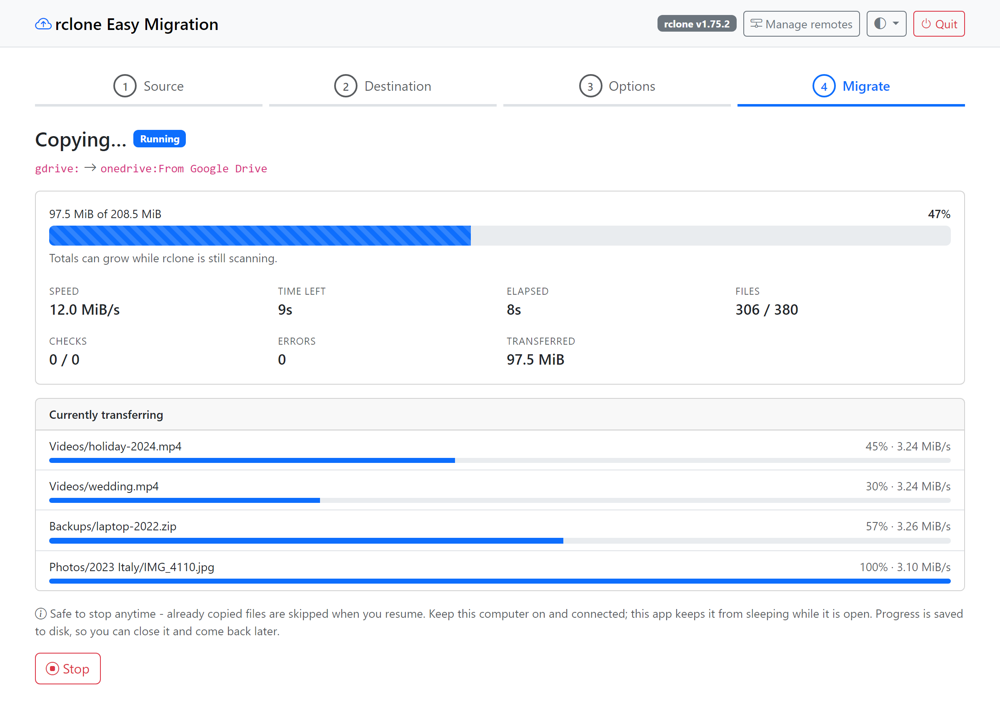
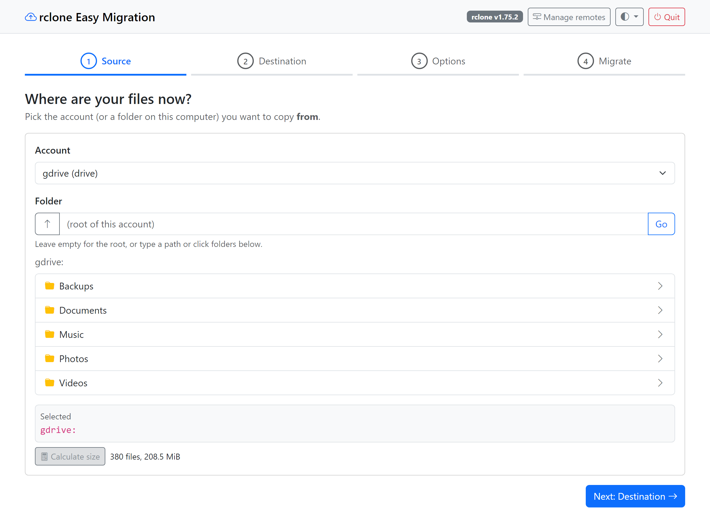
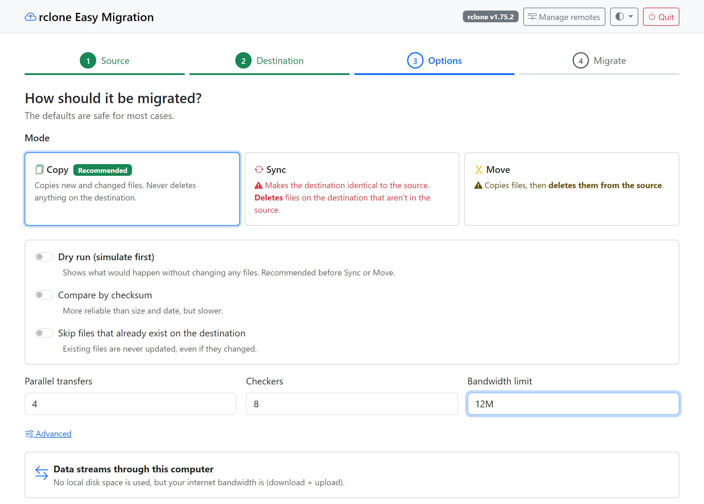

# rclone Easy Migration

A small app that moves your files from one cloud to another — Google Drive to OneDrive, Dropbox to pCloud, whatever you need. Pick where your files are, pick where they should go, press start.

It's a friendly front-end for [rclone](https://rclone.org), which does the actual work.

<picture>
  <source media="(prefers-color-scheme: dark)" srcset="docs/screenshots/progress-dark.png">
  
</picture>

## Download

Get the file for your computer from the [Releases page](../../releases/latest). There's nothing to install.

- **Windows:** `rclone-easy-migration-windows-x64.exe`. Double-click it.
- **Mac:** `rclone-easy-migration-macos-arm64.zip` (M1 and newer) or `macos-x64.zip` (Intel). Unzip and open.
- **Linux:** `rclone-easy-migration-linux-x86_64.AppImage`. Make it executable and run it.

The app isn't code-signed yet, so the first time:

- **Windows:** click *More info*, then *Run anyway*.
- **Mac:** right-click the app, choose *Open*, then confirm.

You'll also need rclone. If you already have it, the app uses it along with your existing cloud accounts. If not, the app offers to download it for you.

## How it works

1. **Source:** choose the account and folder your files are in.
2. **Destination:** choose where they should go (you can create a new folder there).
3. **Options:** choose Copy, Sync or Move.
4. **Migrate:** watch the progress, then hit **Verify** to check both sides match.

To connect a cloud account, click **Manage remotes**, then *Add cloud account*.

<table>
  <tr>
    <td><picture>
      <source media="(prefers-color-scheme: dark)" srcset="docs/screenshots/source-dark.png">
      
    </picture></td>
    <td><picture>
      <source media="(prefers-color-scheme: dark)" srcset="docs/screenshots/options-dark.png">
      
    </picture></td>
  </tr>
</table>

## Copy, Sync or Move?

- **Copy** (default) adds your files to the destination. It never deletes anything.
- **Sync** makes the destination an exact mirror, so it **deletes** files there that aren't in the source.
- **Move** copies everything, then **deletes it from the source**.

Not sure? Use Copy. You can also turn on *dry run* to see what would happen without changing anything.

## Long migrations

Big migrations can take days. That's fine:

- The app keeps your computer awake while it's open (leave a laptop lid open, though).
- You can stop any time, even restart your computer. Open the app again and click **Resume**. Files already copied are skipped.
- When both sides use the same provider, rclone can copy directly inside the cloud, which is much faster.

## Run it without the app

Prefer not to run an executable? Download this repository and run `start.bat` (Windows), `start.command` (Mac) or `./start.sh` (Linux). It opens the same interface in your browser.

## For developers

Built with [Tauri v2](https://v2.tauri.app). The interface in `ui/` is plain HTML, JavaScript and Bootstrap and talks to rclone's [remote control API](https://rclone.org/rc/). You need Node.js, Rust and the [Tauri prerequisites](https://v2.tauri.app/start/prerequisites/).

```sh
npm ci
npm run tauri dev     # develop
npm run build:exe     # Windows exe
npm run tauri build   # Mac .app / Linux AppImage
```

To release, bump the version in `package.json`, `src-tauri/Cargo.toml` and `src-tauri/tauri.conf.json`, then push a tag like `v0.2.0`. GitHub Actions builds all platforms into a draft release.

## Credits

Powered by [rclone](https://rclone.org). The interface uses [Bootstrap](https://getbootstrap.com) and [Bootstrap Icons](https://icons.getbootstrap.com). All MIT licensed.
