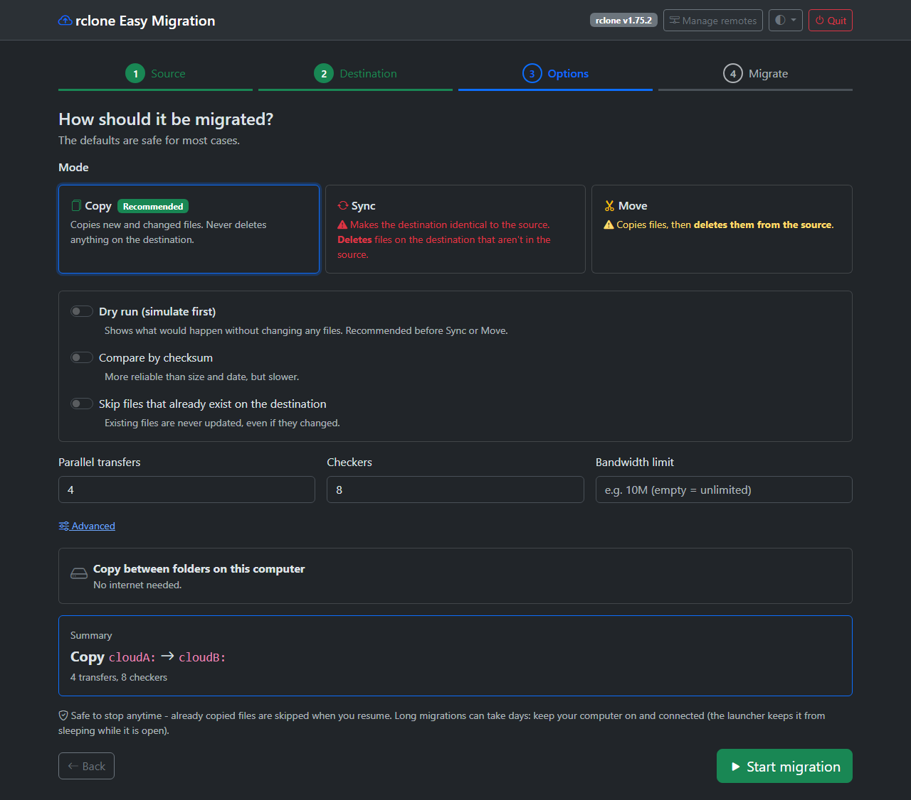

# rclone Easy Migration

Moving everything from one cloud to another — say, Google Drive to OneDrive, or Dropbox to pCloud — shouldn't require learning a command line. [rclone](https://rclone.org) can do it brilliantly, but it's a power tool. This is a small app that puts a friendly face on the one thing most people need it for: **getting your files from cloud A to cloud B**.

You pick where your files are, pick where they should go, press start, and watch them move.



## Getting it

There's no installer. Grab the file for your computer from the [Releases page](../../releases/latest) and open it:

- **Windows** — `rclone-easy-migration-windows-x64.exe`. Double-click it. Put it on your Desktop or wherever you like.
- **Mac** — `rclone-easy-migration-macos-arm64.zip` for Apple Silicon (M1 and newer), or `macos-x64.zip` for older Intel Macs. Unzip it and open the app.
- **Linux** — `rclone-easy-migration-linux-x86_64.AppImage`. Make it executable (`chmod +x`) and run it.

A heads-up: the app isn't code-signed yet, so the first time you open it your computer will be a bit suspicious.

- On **Windows** you'll see "Windows protected your PC". Click *More info*, then *Run anyway*.
- On a **Mac**, right-click the app and choose *Open*, then confirm. (Or go to *System Settings → Privacy & Security* and click *Open Anyway*.)

After that it opens normally.

## You'll need rclone

The app is a front-end for rclone, so it needs rclone on your computer. If you already use rclone, great — the app finds it and all the cloud accounts you've already set up show up straight away. Nothing gets copied or changed in your setup.

If you don't have rclone yet, the app will notice and offer to download it for you (it checks the download against rclone's official checksums). You can also point it at an rclone file yourself.

<details>
<summary>Where does it look for rclone?</summary>

In this order: the `RCLONE_PATH` environment variable, your `PATH`, the usual install locations (winget, Scoop, Chocolatey, Homebrew, snap, `/usr/local/bin`, and so on), and finally a copy the app downloaded itself. If yours lives somewhere unusual, set `RCLONE_PATH` to the full path, e.g. `D:\tools\rclone.exe`.
</details>

## How it works

1. **Source** — choose the account and folder your files are in now.
2. **Destination** — choose where they should end up. You can make a new folder right there if you need one.
3. **Options** — choose how to migrate (more on that below). The defaults are sensible.
4. **Migrate** — start it and watch the progress: speed, time left, which files are on their way.

When it's done, hit **Verify** to have rclone double-check that both sides match.

Don't have your clouds connected yet? Click **Manage remotes**, then *Add cloud account*, pick your provider and sign in. For services like Google Drive or OneDrive, your browser opens so you can log in and give rclone access.

## Copy, Sync or Move?

This is the one choice that really matters, so here it is in plain words:

- **Copy** (the default) puts your files on the destination and never deletes anything anywhere. If you're unsure, use this.
- **Sync** makes the destination an exact mirror of the source. That means it **deletes** anything on the destination that isn't in the source. Great for keeping a mirror; dangerous if you mix up source and destination.
- **Move** copies everything over and then **deletes it from the source**.

Sync and Move ask you to confirm before they start. There's also a *dry run* switch that shows what *would* happen without touching anything — worth using before a Sync or Move.

## Big migrations

Moving a few hundred gigabytes can take a day or more, and that's fine. The app is built for it:

- **It keeps your computer awake** while it's open, so it won't fall asleep halfway through. (Your screen can still turn off. Closing a laptop lid may still put it to sleep, though, so leave it open.)
- **You can stop any time.** Close the app, restart your computer, come back tomorrow. Open the app again and you'll see a **Resume** button. Files that already made it across are skipped, so it picks up where it left off. One catch: a large file that was halfway through starts over from the beginning.
- **Same provider on both sides?** When it can, rclone copies directly inside the cloud (for example between two Google Drive accounts), so the data doesn't have to travel through your internet connection at all. The app tells you when that's happening.
- Otherwise the files stream *through* your computer — nothing is stored on your disk, but it does use your internet connection.
- Google Drive only accepts about 750 GB of uploads per day per account. If you hit that, the app stops cleanly; just resume the next day.

There's a log of everything in the app's log folder (theme menu → *Open log folder*) if you ever need to see what happened.

## Good to know

- Everything runs on your own computer. The app starts rclone in the background, talks to it privately, and stops it when you close the app.
- Your cloud logins are stored in rclone's own config file, just like when you use rclone directly. Treat that file (`rclone config file` shows where it is) like a password.
- Some things rclone can't fix for you: provider quotas, file names one cloud allows and another doesn't, or Google Docs/Sheets that only exist as Google formats. Keep a backup of anything you can't afford to lose.

## No app? Run it from the folder

If you'd rather not run an executable, you can download this repository and start the same interface in your browser with a script:

- Windows: double-click `start.bat`
- Mac: double-click `start.command`
- Linux: run `./start.sh`

It finds your rclone the same way, starts it privately on your computer and opens your browser. If your browser asks for a username and password, they're printed in the window that opened. Close that window (or click *Quit*) to stop.

## For developers

The app is a [Tauri v2](https://v2.tauri.app) project. The interface is plain HTML, JavaScript and Bootstrap in `ui/` — no frontend build step — and talks to rclone's [remote control API](https://rclone.org/rc/). The Rust side in `src-tauri/` finds rclone, starts `rclone rcd` with a random login on `127.0.0.1`, keeps the computer awake and cleans up on exit.

You'll need Node.js (LTS), Rust (stable) and the [Tauri prerequisites](https://v2.tauri.app/start/prerequisites/) for your platform. Then:

```sh
npm ci
npm run tauri dev     # run it while developing
npm run build:exe     # Windows: single exe in src-tauri/target/release/
npm run tauri build   # macOS .app / Linux AppImage in src-tauri/target/release/bundle/
```

To publish a release, set the same version in `package.json`, `src-tauri/Cargo.toml` and `src-tauri/tauri.conf.json`, then push a tag like `v0.2.0`. GitHub Actions builds the Windows, Mac and Linux files and puts them on a draft release for you to check and publish.

## Credits

All the heavy lifting is done by [rclone](https://rclone.org) (MIT licensed), which isn't bundled here. The interface uses [Bootstrap](https://getbootstrap.com) and [Bootstrap Icons](https://icons.getbootstrap.com) (both MIT; licenses in `ui/vendor/`).
